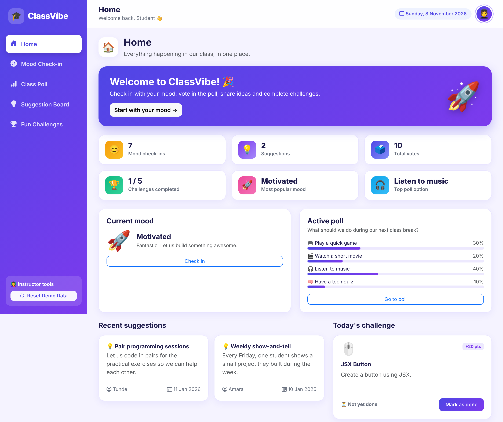

# 🎓 ClassVibe – The Interactive Class Hub

A beginner-friendly **React** learning project: a colourful classroom dashboard where students check in with their mood, vote in a poll, post suggestions and complete fun challenges. It is built to teach React fundamentals week by week (see the [learning manual](deliverables/ClassVibe_React_Learning_Manual.pdf)).



## Features

- **Dashboard** – statistics calculated from real data (check-ins, suggestions, votes, completed challenges, most popular mood and poll option), plus previews of the current mood, active poll, recent suggestions and today's challenge. Includes empty states.
- **Mood Check-in** – five selectable mood cards, confirmation message, optional note, mood summary and latest check-ins.
- **Class Poll** – vote counts, percentage progress bars, leading option highlight, one vote per browser (stored in `localStorage`), instructor controls (*Next student can vote*, *Reset poll*).
- **Suggestion Board** – controlled form with friendly validation, suggestion cards with name and date, delete, empty state.
- **Fun Challenges** – five challenge cards, mark done / undo, progress bar and points, reset.
- **Persistence** – everything is saved in `localStorage` and survives a refresh.
- **Reset Demo Data** – instructor button (sidebar footer; bottom of Home on mobile) with confirmation.
- **Responsive** – sidebar on desktop, bottom navigation on tablets/phones.

## Technologies

React 19 (Create React App, JavaScript, functional components + hooks) · React Router DOM 6 · Bootstrap 5 + Bootstrap Icons · CSS3 · browser `localStorage`. No backend, no Redux, no TypeScript, no Tailwind.

## Installation and running

Requires Node.js 18+ (tested with Node 22) and npm.

```bash
npm install
npm start          # development server at http://localhost:3000
npm run build      # production build into ./build
```

## Project structure

```text
src/
  components/   Navbar, Sidebar, StatCard, MoodCard, PollOption,
                SuggestionCard, ChallengeCard, PageHeader, ResetButton
  pages/        Dashboard, MoodCheckin, ClassPoll, Suggestions, Challenges
  data/         moods.js, poll.js, challenges.js, pages.js, sampleData.js
  storage.js    small localStorage helpers
  App.js        shared state + routes      App.css / index.css   styles
  index.js      starts React and BrowserRouter
public/         index.html, favicon, manifest, _redirects (Netlify SPA routing)
docs/           REACT_CONCEPT_MAPPING.md, ClassVibe_React_Learning_Manual.md
deliverables/   PDF manual, demo video (MP4), screenshots/, project ZIP
```

## React concepts used

JSX and conditional rendering · functional components & composition · props · `onClick` / `onChange` / `onSubmit` · lists with `.map()` and keys · Fragments · `useState` (numbers, arrays, objects) · controlled and uncontrolled inputs · validation · `useRef` (focus + uncontrolled note) · `useEffect` (save to localStorage, page title) · React Router (`BrowserRouter`, `Routes`, `Route`, `NavLink`, `Link`, `useLocation`, `Navigate`) · production build. Full mapping: [docs/REACT_CONCEPT_MAPPING.md](docs/REACT_CONCEPT_MAPPING.md).

## Resetting demo data

Click **Reset Demo Data** (bottom of the sidebar, or bottom of the Home page on small screens) and confirm. All ClassVibe `localStorage` keys are cleared and the original sample check-ins, votes, suggestions and challenge progress are restored. The poll and challenges pages also have their own reset buttons.

## Known limitations

- **Frontend only:** data is stored in each browser's `localStorage`, so different students' browsers do **not** share data. Project the app on one computer and let students take turns (use **Next student can vote** on the poll page).
- "One vote per browser" can be bypassed by clearing browser data – acceptable for a classroom demo.
- No authentication, backend or database by design.
- The learning manual's early-week snippets are deliberately simplified; the final code in `src/` is the reference.
