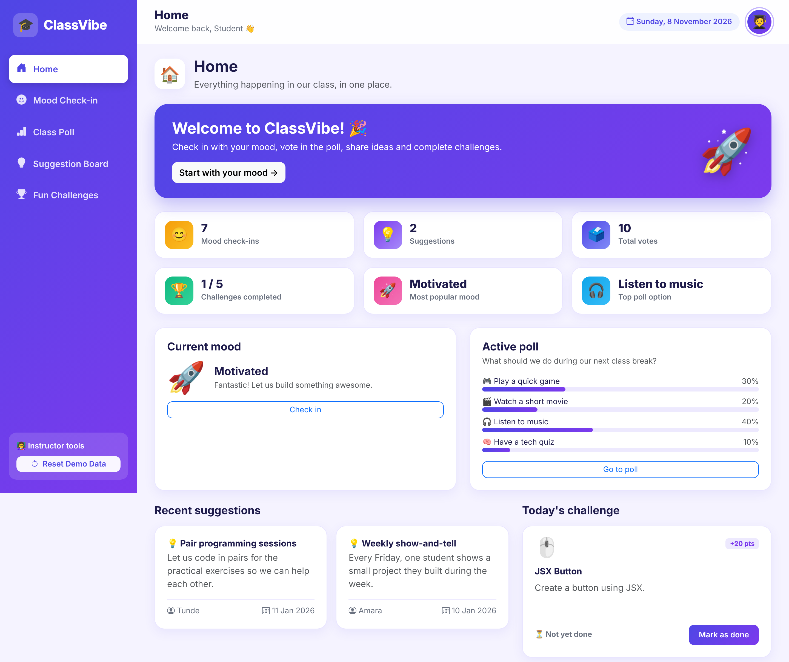
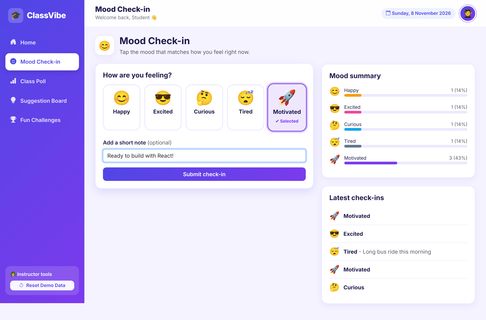
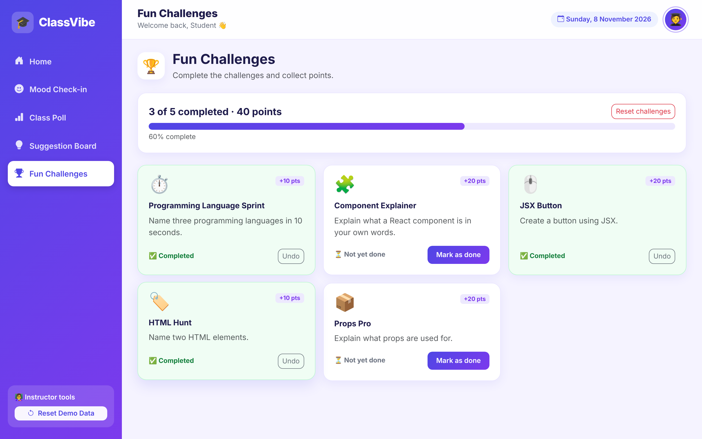
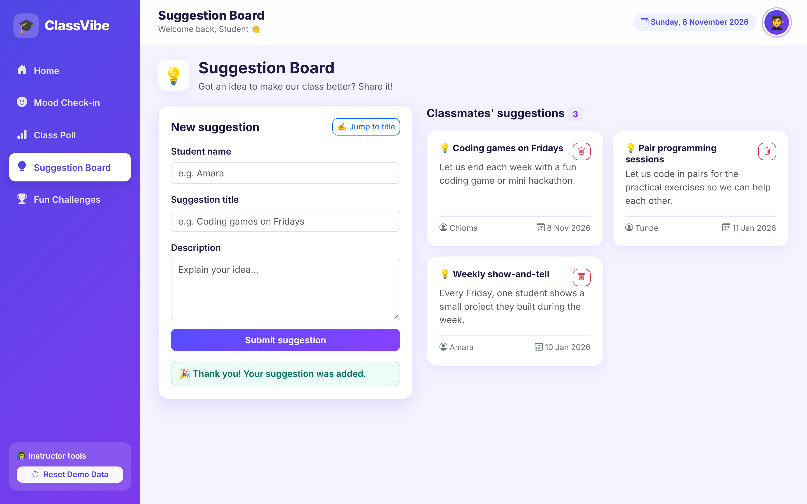
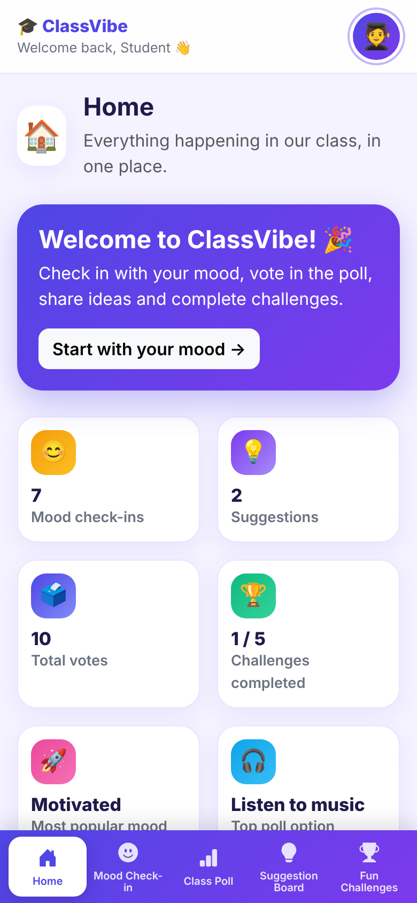

# CLASSVIBE: A PRACTICAL REACT DEVELOPMENT MANUAL {.unnumbered}

*Learn React by Building an Interactive Classroom Application*

**Contents:** Welcome · Week 1 Introduction · Week 2 Components & Props · Week 3 Events · Week 4 Lists · Week 5 State & Forms · Week 6 useRef & useEffect · Week 7 Navigation & Deployment · Final Assessment · Glossary

---

# Welcome to ClassVibe {.unnumbered}

In this course you will build **ClassVibe – The Interactive Class Hub**, a colourful classroom dashboard where students can:

- check in with their **mood** 😊
- vote in a **class poll** 📊
- post and read **suggestions** 💡
- complete fun **challenges** 🏆
- see live **statistics** about all of the above.

You will not just read about React – you will build a real application **one week at a time**. Each week adds one new idea, and by Week 7 you will have a finished app that you can put on the internet.

## How to use this manual {.unnumbered}

Every week has the same layout so you always know where you are:

| Section | What it is for |
|---|---|
| **Learning objectives** | What you will be able to do by the end of the week |
| **Concepts** | The ideas, explained in plain language |
| **Step-by-step practical** | Instructions to follow on your computer |
| **Code explained** | Why the important lines are written the way they are |
| **Expected output** | What you should see when it works |
| **Classroom exercise** | A short task to do in the lesson |
| **Homework** | Practice for the week |
| **Common mistakes** | Errors every beginner makes, and how to fix them |
| **Weekly checklist** | Tick everything before the next lesson |

::: {.note}
**Code in this manual matches the real project.** Where a snippet is *simplified* for teaching (for example, an early version before a feature is added), it is labelled **"Simplified version"** and the text explains how the final project differs. Snippets labelled **"Final project code"** are copied directly from the source files.
:::

## The ClassVibe project at a glance {.unnumbered}

{width=100%}

| Page | URL | What students do |
|---|---|---|
| Home | `/` | See statistics, previews and today's challenge |
| Mood Check-in | `/mood` | Pick a mood and submit a check-in |
| Class Poll | `/poll` | Vote once and watch the results |
| Suggestion Board | `/suggestions` | Submit and read ideas |
| Fun Challenges | `/challenges` | Mark challenges as completed |

## Important classroom limitation {.unnumbered}

::: {.warning}
**ClassVibe is a frontend-only project.** It stores everything in your browser's `localStorage`. This means **different students' computers do not share data** – your votes on your laptop will not appear on your classmate's laptop.
:::

That is fine for learning, and it is how we use the app in class:

1. The **instructor opens ClassVibe on one computer and projects it** on the screen.
2. Students come to that computer **one after another** to check in, vote, and submit suggestions.
3. After a student votes, the instructor clicks **"Next student can vote"** on the Class Poll page so the next person can vote on the same browser. (The app blocks repeated voting from the same browser until this is clicked.)
4. Before a new class, the instructor clicks **Reset Demo Data** (bottom of the sidebar) to restore the original sample data.

Sharing data between computers needs a *backend server and database*, which is a topic for a later course.

<div style="page-break-after: always;"></div>

# Week 1: Introduction to React and the Development Environment

## Learning objectives

By the end of this week you will be able to:

- explain what React is and why developers use it;
- describe the Virtual DOM in simple words;
- write simple JSX;
- install Node.js and npm and check that they work;
- create a React app with Create React App and start the development server;
- find your way around the project folders;
- build the first ClassVibe welcome page.

## Concepts

### What is React?

**React** is a JavaScript library for building user interfaces (the parts of a website people see and click). Instead of writing one huge web page, you build small, reusable pieces called **components** – like LEGO® bricks – and put them together.

### Why is React useful?

- **Reusable:** build a `MoodCard` once and use it five times.
- **Fast to update:** when data changes, React updates only the part of the page that changed.
- **Predictable:** you describe *what the screen should look like* for the current data, and React does the rest.
- **Popular:** huge community, many jobs, lots of help online.

### The Virtual DOM (simply explained)

The browser shows a web page using the **DOM** – a tree of elements (headings, buttons, paragraphs). Changing the real DOM is slow if you do it a lot.

React keeps a lightweight *copy* of the page in memory called the **Virtual DOM**. When your data changes, React:

1. builds a new Virtual DOM,
2. compares it with the old one (this is called *diffing*),
3. changes **only the differences** in the real DOM.

> **Analogy:** Imagine editing an essay. Instead of rewriting the whole essay every time, React finds the one word that changed and fixes only that word.

### What is JSX?

**JSX** looks like HTML inside JavaScript. The browser cannot read JSX directly – the tools in your project convert it to normal JavaScript for you.

```javascript
const name = 'Amara';
const element = <h1>Hello, {name}! 👋</h1>;
```

Rules of JSX you must remember:

| Rule | Example |
|---|---|
| Use `{ }` to put JavaScript inside JSX | `<p>{2 + 3}</p>` shows 5 |
| Use `className` instead of `class` | `<div className="card">` |
| Every tag must be closed | `<input />`, `` |
| Return **one** parent element | wrap siblings in a `<div>` or `<>...</>` |
| Conditional rendering | `{isHappy && <p>😊</p>}` |

## Step-by-step practical

### Step 1 – Install Node.js and npm

1. Download the **LTS** version of Node.js from <https://nodejs.org> and install it.
2. Open a terminal (Command Prompt, PowerShell, Terminal) and check:

```bash
node -v
npm -v
```

You should see two version numbers (for example `v22.x.x` and `10.x.x`). **npm** (Node Package Manager) comes with Node.js and downloads code libraries for us.

### Step 2 – Create the app with Create React App

```bash
npx create-react-app classvibe
cd classvibe
npm start
```

- `npx create-react-app classvibe` creates a new folder called `classvibe` with a ready-made React project (this takes a few minutes).
- `npm start` starts the **development server**. Your browser opens `http://localhost:3000` and shows the React starter page.
- Leave the terminal running. Press **Ctrl + C** to stop it.

### Step 3 – Understand the folder structure

```text
classvibe/
├── node_modules/     (downloaded libraries - never edit!)
├── public/
│   └── index.html    (the single HTML page; has <div id="root">)
├── src/
│   ├── index.js      (starts React and puts <App /> inside #root)
│   ├── index.css     (global styles)
│   └── App.js        (our first component)
├── package.json      (project name, scripts, dependencies)
└── README.md
```

The most important flow: **`public/index.html`** has an empty `<div id="root">`, and **`src/index.js`** tells React to draw `<App />` inside it.

### Step 4 – Install the libraries ClassVibe uses

```bash
npm install bootstrap@5 bootstrap-icons@1
```

Bootstrap gives us a grid and ready-made buttons and forms. In `src/index.js` import it:

```javascript
import 'bootstrap/dist/css/bootstrap.min.css';
import 'bootstrap-icons/font/bootstrap-icons.css';
```

### Step 5 – Build the first ClassVibe welcome page

Clean up the starter project: delete `App.test.js`, `logo.svg` and `reportWebVitals.js` (and remove their imports), then replace **`src/App.js`** with:

```javascript
// Simplified version (Week 1) - the final App.js is much bigger.
function App() {
  const appName = 'ClassVibe';
  const today = new Date().toLocaleDateString('en-GB', {
    weekday: 'long', day: 'numeric', month: 'long', year: 'numeric',
  });

  return (
    <div className="container py-5 text-center">
      <h1 className="display-4 fw-bold">🎓 Welcome to {appName}!</h1>
      <p className="lead">The Interactive Class Hub</p>
      <p>Today is {today}</p>
      <button className="btn btn-primary">Let's go 🚀</button>
    </div>
  );
}

export default App;
```

## Code explained

- `function App() { ... }` is a **component** – a function that returns JSX.
- `{appName}` and `{today}` are **JSX expressions**: React replaces them with the values of the JavaScript variables.
- `export default App;` lets other files import this component. `index.js` does `import App from './App'`.
- Notice `className` (not `class`).

## Expected output

A white page with a large heading **"🎓 Welcome to ClassVibe!"**, the subtitle, today's date and a blue **"Let's go 🚀"** button. If you change the text and save, the browser updates by itself (*hot reload*).

## Classroom exercise

1. Add a second line under the date showing your name using a variable: `const student = 'Your Name'`.
2. Show the message **"Good morning"** if `new Date().getHours() < 12`, otherwise **"Good afternoon"**, using a conditional expression: `{hour < 12 ? 'Good morning' : 'Good afternoon'}`.

## Homework

- Create a new component-free page about yourself using at least five JSX expressions (name, age, favourite language, a calculation, and today's date).
- Write three sentences in your own words explaining the Virtual DOM.

## Common beginner mistakes

| Mistake | What you see | Fix |
|---|---|---|
| Using `class="..."` | Console warning | Use `className` |
| Forgetting to close a tag (`<input>`) | Compile error | Write `<input />` |
| Two sibling elements returned with no parent | "Adjacent JSX elements must be wrapped" | Wrap them in `<div>` or `<>…</>` |
| Running `npm start` in the wrong folder | "Missing script: start" | `cd classvibe` first |
| Editing files inside `node_modules` | Changes vanish | Never edit it |

## Weekly checklist

- [ ] Node.js and npm installed and checked with `-v`
- [ ] App created and running on `localhost:3000`
- [ ] I can explain components, JSX and the Virtual DOM
- [ ] Bootstrap installed and imported
- [ ] Welcome page shows my own variables

<div style="page-break-after: always;"></div>

# Week 2: Functional Components and Props

## Learning objectives

- explain what a component is and write **functional components**;
- **import and export** components between files;
- pass data to a component using **props**;
- reuse one component many times with different data;
- apply basic styling to components.

## Concepts

### Components

A **component** is a reusable piece of UI. In modern React, a component is a **function** whose name starts with a **capital letter** and that **returns JSX**.

### Props

**Props** (short for *properties*) are the inputs of a component – like arguments of a function. The parent gives them, the child reads them. **Props are read-only**: a component must never change its own props.

```text
          App  (has the data)
         /    \
  StatCard     StatCard      <-- each receives different props
```

### Composition

Components can be placed inside other components. A **page** is built by composing small components – this is called **composition**.

## Step-by-step practical

### Step 1 – Create the folders

Inside `src` create `components/`, `pages/` and `data/`.

### Step 2 – Create the data file for moods

Create `src/data/moods.js`. Each mood is a plain JavaScript object:

```{.javascript}
// DATA: the moods students can choose from.
// Each mood is a plain JavaScript object. MoodCard receives one of these as a prop.
export const MOODS = [
  { id: 'happy', label: 'Happy', emoji: '😊', color: '#f59e0b', message: 'Great to hear you are happy today!' },
  { id: 'excited', label: 'Excited', emoji: '😎', color: '#ec4899', message: 'Love the energy - let us make it a great class!' },
  { id: 'curious', label: 'Curious', emoji: '🤔', color: '#0ea5e9', message: 'Curiosity is the best way to learn React.' },
  { id: 'tired', label: 'Tired', emoji: '😴', color: '#64748b', message: 'Hang in there - we will take it step by step.' },
  { id: 'motivated', label: 'Motivated', emoji: '🚀', color: '#7c3aed', message: 'Fantastic! Let us build something awesome.' },
];
```

`export const MOODS` makes the array available to other files (a **named export**), which are imported with curly braces: `import { MOODS } from '../data/moods';`.

### Step 3 – Build StatCard

**Final project code** – `src/components/StatCard.js`:

```{.javascript}
// CONCEPT: a reusable function component that receives data through PROPS.
function StatCard({ icon, label, value, color }) {
  return (
    <div className="cv-card cv-stat h-100">
      <div className="cv-stat-icon" style={{ background: color }}>
        {icon}
      </div>
      <div>
        <div className="cv-stat-value">{value}</div>
        <div className="cv-stat-label">{label}</div>
      </div>
    </div>
  );
}

export default StatCard;
```

Look at the first line: `function StatCard({ icon, label, value, color })`. The curly braces **destructure** the props object, so we can write `{value}` instead of `props.value`.

### Step 4 – Build MoodCard (non-interactive first)

**Simplified version (Week 2)** – the final MoodCard also has an `onClick` and a selected style, added in Week 3:

```javascript
function MoodCard({ mood }) {
  return (
    <div className="cv-mood">
      <span className="cv-mood-emoji">{mood.emoji}</span>
      <span className="cv-mood-label">{mood.label}</span>
    </div>
  );
}

export default MoodCard;
```

### Step 5 – Render several cards with props

In `App.js` (simplified – in the final app these live in `Dashboard.js` and `MoodCheckin.js`):

```javascript
import StatCard from './components/StatCard';
import MoodCard from './components/MoodCard';
import { MOODS } from './data/moods';

function App() {
  return (
    <div className="container py-4">
      <h1>🎓 ClassVibe</h1>

      <div className="row g-3 my-3">
        <div className="col-6"><StatCard icon="😊" label="Mood check-ins" value={7} color="#f59e0b" /></div>
        <div className="col-6"><StatCard icon="💡" label="Suggestions" value={2} color="#7c3aed" /></div>
      </div>

      <MoodCard mood={MOODS[0]} />
      <MoodCard mood={MOODS[1]} />
      <MoodCard mood={MOODS[2]} />
    </div>
  );
}
export default App;
```

::: {.note}
Here the numbers `7` and `2` are typed in by hand so you can see props working. In the **final** project every number is **calculated from real data** (see `Dashboard.js`).
:::

### Step 6 – Styling

Create `src/App.css` and `import './App.css';` in `App.js`. ClassVibe's design uses **CSS variables** for colours (in `index.css`) so the whole look can be changed in one place:

```css
:root {
  --cv-indigo: #4f46e5;
  --cv-purple: #7c3aed;
  --cv-bg: #f5f3ff;
}
```

## Code explained

- `<StatCard icon="😊" value={7} />` – text props use quotes, **everything else (numbers, variables, objects) uses `{ }`**.
- `mood={MOODS[0]}` passes a whole object as one prop; inside MoodCard we read `mood.emoji` and `mood.label`.
- One function, many cards: that is **reusability**.

## Expected output

Two rounded white statistic cards with coloured icons, and three mood cards (😊 Happy, 😎 Excited, 🤔 Curious).

{width=100%}

## Classroom exercise

Create a `ChallengeCard` that receives `challenge` as a prop and shows its emoji, title and description. Render the first three challenges from `src/data/challenges.js`.

## Homework

1. Add a third and fourth `StatCard` showing *Total votes* and *Completed challenges*.
2. Add a new mood (for example *Confused 😕*) to `moods.js` and confirm that a new card appears **without changing MoodCard**.

## Common beginner mistakes

| Mistake | Fix |
|---|---|
| Component name starts with a small letter (`statCard`) | Components must start with a capital letter |
| `value="7"` when you need a number | Use `value={7}` |
| Forgetting `export default` | Add it, or you will see "does not contain a default export" |
| Wrong import path (`./StatCard` vs `./components/StatCard`) | Check the folder; `../` means "go up one folder" |
| Trying to change a prop inside the child | Props are read-only. Ask the parent to change the data |

## Weekly checklist

- [ ] `StatCard` and `MoodCard` exist in `src/components`
- [ ] I can explain props in one sentence
- [ ] The same component is used several times with different data
- [ ] `moods.js` is imported using a named import
- [ ] I styled my cards using CSS

<div style="page-break-after: always;"></div>

# Week 3: Events and User Interactions

## Learning objectives

- handle **onClick**, **onChange** and **onSubmit** events;
- write **event handler functions**;
- use **useState** to make the screen react to clicks;
- make mood cards selectable and add poll voting buttons.

## Concepts

### Events

An **event** is something that happens: a click, typing, submitting a form. In React you attach a handler with camelCase attributes:

```javascript
<button onClick={handleClick}>Click me</button>
```

::: {.warning}
Write `onClick={handleClick}` – **not** `onClick={handleClick()}`. With the brackets the function runs immediately while the page is drawn.
:::

| Event | Used when | ClassVibe example |
|---|---|---|
| `onClick` | A button/card is clicked | Selecting a mood, voting |
| `onChange` | The value of an input changes | Typing in the suggestion form (Week 5) |
| `onSubmit` | A form is submitted | Submitting a suggestion (Week 5) |

### Introduction to useState

Normal variables do not make React redraw the screen. **State** does.

```javascript
const [count, setCount] = useState(0);
```

- `count` – the current value
- `setCount` – the function that changes the value **and tells React to redraw**
- `0` – the starting value

### A first example

```javascript
import { useState } from 'react';

function LikeButton() {
  const [likes, setLikes] = useState(0);

  function handleClick() {
    setLikes(likes + 1);
  }

  return <button onClick={handleClick}>👍 {likes}</button>;
}
```

## Step-by-step practical

### Step 1 – Make MoodCard clickable

**Final project code** – `src/components/MoodCard.js`:

```{.javascript}
// CONCEPTS: props, onClick event, conditional class name.
// The parent decides which mood is selected (isSelected) and what happens on click (onSelect).
function MoodCard({ mood, isSelected, onSelect }) {
  return (
    <button
      type="button"
      className={isSelected ? 'cv-mood selected' : 'cv-mood'}
      style={{ '--mood-color': mood.color }}
      onClick={() => onSelect(mood.id)}
      aria-pressed={isSelected}
    >
      <span className="cv-mood-emoji">{mood.emoji}</span>
      <span className="cv-mood-label">{mood.label}</span>
      {isSelected && <span className="cv-mood-tick">✔ Selected</span>}
    </button>
  );
}

export default MoodCard;
```

MoodCard **does not own** the selection. Its parent passes `isSelected` and `onSelect`. This pattern – *data goes down as props, events go up as functions* – is the heart of React.

### Step 2 – Keep the selection in state

**Simplified version (Week 3)** – a first `MoodCheckin` page without the check-in history. The final version is shown in Week 6.

```javascript
import { useState } from 'react';
import MoodCard from '../components/MoodCard';
import { MOODS } from '../data/moods';

function MoodCheckin() {
  const [selectedMoodId, setSelectedMoodId] = useState(null);

  return (
    <div>
      <h2>How are you feeling?</h2>
      {/* map() is explained properly in Week 4 */}
      {MOODS.map((mood) => (
        <MoodCard
          key={mood.id}
          mood={mood}
          isSelected={mood.id === selectedMoodId}
          onSelect={setSelectedMoodId}
        />
      ))}
      {selectedMoodId !== null && <p>You picked: {selectedMoodId}</p>}
    </div>
  );
}
export default MoodCheckin;
```

When a card is clicked, `onSelect(mood.id)` calls `setSelectedMoodId`, state changes, React redraws and the card gets the `selected` style.

### Step 3 – The poll option with a Vote button

Create `src/data/poll.js` and the `PollOption` component. **Final project code** – `src/components/PollOption.js`:

```{.javascript}
// CONCEPTS: props, events, conditional rendering, a percentage progress bar.
function PollOption({ option, votes, totalVotes, isLeading, isMyVote, hasVoted, onVote }) {
  // Work out the percentage. Avoid dividing by zero when nobody has voted.
  const percent = totalVotes === 0 ? 0 : Math.round((votes / totalVotes) * 100);

  let className = 'cv-poll-option';
  if (isLeading) className += ' leading';
  if (isMyVote) className += ' mine';

  return (
    <div className={className}>
      <div className="d-flex align-items-center justify-content-between gap-2 flex-wrap">
        <div className="cv-poll-label">
          <span className="fs-4 me-2">{option.emoji}</span>
          {option.label}
          {isLeading && <span className="badge cv-badge-lead ms-2">👑 Leading</span>}
          {isMyVote && <span className="badge cv-badge-mine ms-2">Your vote</span>}
        </div>
        <button
          type="button"
          className="btn btn-sm cv-btn-primary"
          onClick={() => onVote(option.id)}
          disabled={hasVoted}
        >
          Vote
        </button>
      </div>

      <div className="cv-progress mt-3">
        <div className="cv-progress-bar" style={{ width: percent + '%' }}></div>
      </div>
      <div className="d-flex justify-content-between small text-muted mt-1">
        <span>
          {votes} {votes === 1 ? 'vote' : 'votes'}
        </span>
        <strong>{percent}%</strong>
      </div>
    </div>
  );
}

export default PollOption;
```

### Step 4 – Voting with useState

**Simplified version (Week 3)** – votes live in the page itself. In Week 5 we move them to `App.js` so the dashboard can also read them.

```javascript
import { useState } from 'react';
import PollOption from '../components/PollOption';
import { POLL } from '../data/poll';

function ClassPoll() {
  const [votes, setVotes] = useState({ game: 0, movie: 0, music: 0, quiz: 0 });

  function handleVote(optionId) {
    // copy the object, change ONE value
    setVotes({ ...votes, [optionId]: votes[optionId] + 1 });
  }
  // ...render <PollOption /> for each option (Week 4)
}
```

## Code explained

- `onClick={() => onSelect(mood.id)}` – we use an **arrow function** so we can pass an argument (`mood.id`). Without the arrow function, `onSelect(mood.id)` would run immediately.
- `{ ...votes, [optionId]: votes[optionId] + 1 }` – the **spread operator** copies every vote; `[optionId]:` is a **computed key** that replaces just one. **We never change state directly** (`votes.game++` is wrong); we create a new object.
- `disabled={hasVoted}` switches the button off after voting.
- `percent` is *calculated* from the data every render – we never store it.

## Expected output

Clicking a mood card highlights it with a coloured border and a "✔ Selected" tag. Clicking another card moves the highlight. On the poll page, each **Vote** click raises a count and the progress bar grows.

{width=100%}

## Classroom exercise

Add a "Clear selection" button to the mood page that calls `setSelectedMoodId(null)`.

## Homework

1. Make a **counter** component with **+**, **−** and **Reset** buttons.
2. Show the message "Great choice!" only when the selected mood is `motivated` (conditional rendering with `&&`).

## Common beginner mistakes

| Mistake | Fix |
|---|---|
| `onClick={handleVote()}` | `onClick={handleVote}` or `onClick={() => handleVote(id)}` |
| `votes.game = votes.game + 1` | Never change state directly – call the setter with a **new** object |
| `onclick` (lowercase) | React uses camelCase: `onClick` |
| Calling `setCount(count + 1)` twice and expecting +2 | State updates are batched; use `setCount(c => c + 1)` when needed |
| Forgetting to import `useState` | `import { useState } from 'react';` |

## Weekly checklist

- [ ] Mood cards can be selected and the highlight moves
- [ ] I know the difference between `onClick={fn}` and `onClick={fn()}`
- [ ] Votes increase using `useState`
- [ ] I never change state directly
- [ ] I can explain "data down, events up"

<div style="page-break-after: always;"></div>

# Week 4: Lists and Fragments

## Learning objectives

- use JavaScript arrays and the methods `map`, `filter`, `find` and `reduce`;
- render lists with `.map()` and give every item a unique **key**;
- use **Fragments** to avoid extra wrapper elements;
- display suggestions and challenges dynamically from arrays.

## Concepts

### Arrays in JavaScript

```javascript
const languages = ['JavaScript', 'Python', 'HTML'];
languages.length;                           // 3
languages.map((l) => l.toUpperCase());      // new array, same size
languages.filter((l) => l !== 'HTML');      // new array, only matching items
languages.find((l) => l === 'Python');      // the first match
[1, 2, 3].reduce((sum, n) => sum + n, 0);   // 6 (adds everything up)
```

### Rendering a list with map()

```javascript
<ul>
  {languages.map((language) => (
    <li key={language}>{language}</li>
  ))}
</ul>
```

### Why keys matter

React uses the **key** to track which item is which. A good key is **unique and stable** (an `id`). Do **not** use the array index when items can be added, deleted or re-ordered.

### Fragments

A component must return one parent element. If you do not want an extra `<div>`, wrap the pieces in a **Fragment**: `<> ... </>` (or `<React.Fragment key={...}>` when a key is needed).

## Step-by-step practical

### Step 1 – The challenge data

**Final project code** – `src/data/challenges.js`:

```{.javascript}
// DATA: the fun classroom challenges.
export const CHALLENGES = [
  { id: 1, title: 'Programming Language Sprint', description: 'Name three programming languages in 10 seconds.', emoji: '⏱️', points: 10 },
  { id: 2, title: 'Component Explainer', description: 'Explain what a React component is in your own words.', emoji: '🧩', points: 20 },
  { id: 3, title: 'JSX Button', description: 'Create a button using JSX.', emoji: '🖱️', points: 20 },
  { id: 4, title: 'HTML Hunt', description: 'Name two HTML elements.', emoji: '🏷️', points: 10 },
  { id: 5, title: 'Props Pro', description: 'Explain what props are used for.', emoji: '📦', points: 20 },
];
```

### Step 2 – The ChallengeCard

**Final project code** – `src/components/ChallengeCard.js`:

```{.javascript}
// CONCEPTS: props, onClick, conditional rendering based on a true/false prop.
function ChallengeCard({ challenge, isCompleted, onToggle }) {
  return (
    <div className={isCompleted ? 'cv-card cv-challenge done h-100' : 'cv-card cv-challenge h-100'}>
      <div className="d-flex justify-content-between align-items-start">
        <div className="cv-challenge-emoji">{challenge.emoji}</div>
        <span className="badge cv-badge-points">+{challenge.points} pts</span>
      </div>
      <h3 className="h6 fw-bold mt-3">{challenge.title}</h3>
      <p className="text-muted">{challenge.description}</p>
      <div className="d-flex align-items-center justify-content-between mt-auto">
        <span className={isCompleted ? 'cv-status done' : 'cv-status'}>
          {isCompleted ? '✅ Completed' : '⏳ Not yet done'}
        </span>
        <button
          type="button"
          className={isCompleted ? 'btn btn-sm btn-outline-secondary' : 'btn btn-sm cv-btn-primary'}
          onClick={() => onToggle(challenge.id)}
        >
          {isCompleted ? 'Undo' : 'Mark as done'}
        </button>
      </div>
    </div>
  );
}

export default ChallengeCard;
```

### Step 3 – Display all challenges with map()

**Final project code** – the list inside `src/pages/Challenges.js`:

```{.javascript}
      <div className="row g-3">
        {CHALLENGES.map((challenge) => (
          <div className="col-12 col-md-6 col-xl-4" key={challenge.id}>
            <ChallengeCard
              challenge={challenge}
              isCompleted={completed.includes(challenge.id)}
              onToggle={onToggle}
            />
          </div>
        ))}
      </div>
    </>
```

### Step 4 – The SuggestionCard and a list of suggestions

**Final project code** – `src/components/SuggestionCard.js`:

```{.javascript}
// CONCEPTS: props, conditional rendering (the delete button only shows if onDelete is given).
function formatDate(isoString) {
  return new Date(isoString).toLocaleDateString('en-GB', {
    day: 'numeric',
    month: 'short',
    year: 'numeric',
  });
}

function SuggestionCard({ suggestion, onDelete }) {
  return (
    <div className="cv-card cv-suggestion h-100">
      <div className="d-flex justify-content-between align-items-start gap-2">
        <h3 className="h6 fw-bold mb-1">💡 {suggestion.title}</h3>
        {onDelete && (
          <button
            type="button"
            className="btn btn-sm btn-outline-danger"
            onClick={() => onDelete(suggestion.id)}
            aria-label={'Delete suggestion ' + suggestion.title}
          >
            <i className="bi bi-trash"></i>
          </button>
        )}
      </div>
      <p className="text-muted mb-3">{suggestion.description}</p>
      <div className="small cv-suggestion-meta">
        <span>
          <i className="bi bi-person-circle me-1"></i>
          {suggestion.name}
        </span>
        <span>
          <i className="bi bi-calendar3 me-1"></i>
          {formatDate(suggestion.date)}
        </span>
      </div>
    </div>
  );
}

export default SuggestionCard;
```

The **Dashboard** uses a Fragment (`<>...</>`) as its root so that the page header, welcome banner and cards can sit side by side without a useless wrapper `<div>`. Look at the top of the `return` in `Dashboard.js` and in every page.

### Step 5 – A list that builds the sidebar

**Final project code** – `src/data/pages.js`:

```{.javascript}
// DATA: the pages of the app. Used by the Sidebar (to build links) and the Navbar (to show the title).
export const PAGES = [
  { path: '/', label: 'Home', icon: 'bi-house-door-fill', subtitle: 'Your class at a glance' },
  { path: '/mood', label: 'Mood Check-in', icon: 'bi-emoji-smile-fill', subtitle: 'How are you feeling today?' },
  { path: '/poll', label: 'Class Poll', icon: 'bi-bar-chart-fill', subtitle: 'Have your say' },
  { path: '/suggestions', label: 'Suggestion Board', icon: 'bi-lightbulb-fill', subtitle: 'Share your ideas' },
  { path: '/challenges', label: 'Fun Challenges', icon: 'bi-trophy-fill', subtitle: 'Test your skills' },
];
```

The sidebar (Week 7) simply maps over this array to make one link per page – adding a page means adding one object.

### Step 6 – Empty states

Always decide what to show when a list is empty:

```javascript
{suggestions.length === 0 ? (
  <p>No suggestions yet. Add the first one!</p>
) : (
  suggestions.map((s) => <SuggestionCard key={s.id} suggestion={s} />)
)}
```

## Code explained

- `CHALLENGES.map((challenge) => ( ... ))` turns **data** (objects) into **UI** (cards).
- The `key` goes on the **outermost element inside map** – here the `<div className="col-...">`, not on the card inside it.
- `completed.includes(challenge.id)` produces `true` or `false` which becomes the `isCompleted` prop.
- In the real `Suggestions.js` we show newest first using `[...suggestions].reverse()` – we copy first because `reverse()` would otherwise change the original array.

## Expected output

The Challenges page shows five cards in a responsive grid; the Suggestion Board shows each suggestion as a card with name and date, or a friendly empty message when there are none.

{width=100%}

## Classroom exercise

Add a sixth challenge object to `challenges.js`. A new card should appear **without touching any component**. Then explain to a partner why that works.

## Homework

1. Create an array of five favourite foods and render it as a list with proper keys.
2. Use `filter()` to show only the challenges worth 20 points.
3. Use `reduce()` to calculate the total points available.

## Common beginner mistakes

| Mistake | What you see | Fix |
|---|---|---|
| Missing `key` | Warning: "Each child in a list should have a unique key" | Add `key={item.id}` |
| Key placed on the wrong element | Same warning | Put it on the outermost element returned by `map` |
| Using `{ }` instead of `( )` after `=>` and forgetting `return` | Nothing is displayed | Use `=> ( ... )` or add `return` |
| Duplicate keys | Strange behaviour | Use unique ids |
| Mutating with `push` / `reverse` | List does not update | Create a new array with `[...]`, `filter` or `map` |

## Weekly checklist

- [ ] Challenges are drawn from the array with `map()`
- [ ] Every list item has a unique `key`
- [ ] I used a Fragment `<>…</>` at least once
- [ ] Empty states are handled
- [ ] I can explain `map`, `filter`, `find`, `reduce`

<div style="page-break-after: always;"></div>

# Week 5: State Management and Forms

## Learning objectives

- use state for numbers, strings, arrays and objects;
- update **arrays** and **objects** immutably;
- build a **controlled form** with validation;
- understand an **uncontrolled** input;
- "lift state up" so several pages can share data;
- add challenge completion.

## Concepts

### Updating state the React way

Never change state directly. Always create a **new** value:

| Goal | Wrong | Right |
|---|---|---|
| Add to an array | `list.push(x)` | `setList([...list, x])` |
| Remove from an array | `list.splice(i, 1)` | `setList(list.filter(item => item.id !== id))` |
| Change an object | `obj.name = 'Zed'` | `setObj({ ...obj, name: 'Zed' })` |

### Controlled inputs

In a **controlled input**, React state is the single source of truth for the text:

```javascript
<input value={form.name} onChange={handleChange} />
```

Every keystroke runs `onChange`, which updates state, which updates the input.

### Uncontrolled inputs

In an **uncontrolled input**, the browser keeps the text and React reads it only when needed (using a *ref*, Week 6). ClassVibe uses one for the optional **mood note**. Use controlled inputs when you need to validate or react on every keystroke; use uncontrolled for quick, simple values.

### Lifting state up

The Dashboard needs the votes, suggestions and check-ins that other pages change. So the shared state lives in the **parent (`App.js`)**, which passes data **down** as props and handler functions **down** so children can ask for changes.

## Step-by-step practical

### Step 1 – The suggestion form

**Final project code** – the form logic in `src/pages/Suggestions.js` (the full file is in the project):

```{.javascript}
import { useState, useRef, useEffect } from 'react';
import PageHeader from '../components/PageHeader';
import SuggestionCard from '../components/SuggestionCard';

// CONCEPTS: controlled inputs, onChange, onSubmit, validation, updating an object in state,
// useRef (focus), useEffect (document title), .map(), empty state.
function Suggestions({ suggestions, onAdd, onDelete }) {
  // One state object holds all three form fields.
  const [form, setForm] = useState({ name: '', title: '', description: '' });
  const [errors, setErrors] = useState({});
  const [success, setSuccess] = useState('');

  // useRef gives us direct access to the title <input> so we can focus it.
  const titleInputRef = useRef(null);

  // useEffect: the browser tab shows how many suggestions there are.
  useEffect(() => {
    document.title = 'ClassVibe | Suggestions (' + suggestions.length + ')';
  }, [suggestions.length]);

  // Runs on every keystroke. [event.target.name] is the field being typed in.
  function handleChange(event) {
    setForm({ ...form, [event.target.name]: event.target.value });
    setSuccess('');
  }

  function validate() {
    const newErrors = {};
    if (form.name.trim() === '') newErrors.name = 'Please tell us your name.';
    if (form.title.trim() === '') newErrors.title = 'Please give your suggestion a title.';
    else if (form.title.trim().length < 3) newErrors.title = 'The title needs at least 3 characters.';
    if (form.description.trim() === '') newErrors.description = 'Please describe your idea.';
    else if (form.description.trim().length < 10) newErrors.description = 'Tell us a little more (at least 10 characters).';
    return newErrors;
  }

  function handleSubmit(event) {
    event.preventDefault(); // stop the browser from reloading the page
    const newErrors = validate();
    setErrors(newErrors);
    if (Object.keys(newErrors).length > 0) return;

    onAdd({
      id: Date.now(),
      name: form.name.trim(),
      title: form.title.trim(),
      description: form.description.trim(),
      date: new Date().toISOString(),
    });
    setForm({ name: '', title: '', description: '' });
    setSuccess('🎉 Thank you! Your suggestion was added.');
  }

  function focusTitle() {
    titleInputRef.current.focus();
  }
```

### Step 2 – The form's JSX

Each field follows the same pattern (this is the *name* field, shortened):

```javascript
<form onSubmit={handleSubmit} noValidate>
  <label htmlFor="name">Student name</label>
  <input
    id="name"
    name="name"
    className={errors.name ? 'form-control is-invalid' : 'form-control'}
    value={form.name}
    onChange={handleChange}
  />
  {errors.name && <div className="invalid-feedback">{errors.name}</div>}
  {/* ...title and description fields are the same... */}
  <button type="submit">Submit suggestion</button>
</form>
```

### Step 3 – Shared state in App.js

**Final project code** – the suggestion and challenge handlers in `src/App.js`:

```{.javascript}
  // ----- Event handlers (they update state) -----
  function addCheckin(moodId, note) {
    const newCheckin = { id: Date.now(), moodId: moodId, note: note, date: new Date().toISOString() };
    setCheckins([...checkins, newCheckin]); // new array = old items + new item
  }

  function vote(optionId) {
    if (myVote !== null) return; // already voted on this browser
    setVotes({ ...votes, [optionId]: votes[optionId] + 1 }); // new object, one value changed
    setMyVote(optionId);
  }

  function nextStudent() {
    setMyVote(null); // keeps the votes, lets the next student vote
  }

  function resetPoll() {
    setVotes(EMPTY_VOTES);
    setMyVote(null);
  }

  function addSuggestion(suggestion) {
    setSuggestions([...suggestions, suggestion]);
  }

  function deleteSuggestion(id) {
    setSuggestions(suggestions.filter((s) => s.id !== id));
  }

  function toggleChallenge(id) {
    if (completed.includes(id)) {
      setCompleted(completed.filter((c) => c !== id));
    } else {
      setCompleted([...completed, id]);
    }
  }

  function resetChallenges() {
    setCompleted([]);
  }
```

### Step 4 – Challenge completion

`toggleChallenge` above adds the id to the `completed` array, or removes it if it is already there. `ChallengeCard` shows ✅ or ⏳ based on `isCompleted`, and the Challenges page shows a progress bar:

```javascript
const percent = Math.round((done / total) * 100);
<div className="cv-progress-bar" style={{ width: percent + '%' }}></div>
```

## Code explained

- `useState({ name: '', title: '', description: '' })` – **one object** holds all form fields.
- `[event.target.name]: event.target.value` – the input's `name` attribute chooses which field to update, so **one** `handleChange` handles all three inputs.
- `event.preventDefault()` stops the browser from reloading the page when a form is submitted.
- `validate()` builds an **errors object**; if it has any keys, we stop. `Object.keys(newErrors).length > 0` is the check.
- `date: new Date().toISOString()` stores the date as text; `SuggestionCard` formats it for people.
- `id: Date.now()` creates a simple unique id from the current time.

::: {.note}
**Simplified vs final:** Early in this week the state lives inside `Suggestions.js` (`const [suggestions, setSuggestions] = useState([])`). In the **final** project it has been *lifted* to `App.js` and arrives as the `suggestions` prop, together with `onAdd` / `onDelete`.
:::

## Expected output

Submitting an empty form shows three friendly red messages. A valid submission clears the form, shows "🎉 Thank you!", and a new card appears at the top. The 🗑 button removes a card. The challenge counter and progress bar change as you mark challenges.

{width=100%}

## Classroom exercise

Add a validation rule: the student name must be at least 2 characters long. Show the message "Names need at least 2 letters."

## Homework

1. Add a **"Clear all suggestions"** button (use `setSuggestions([])`).
2. Add a character counter under the description: `{form.description.length}/200`.
3. Add a **"category"** `<select>` to the form (controlled).

## Common beginner mistakes

| Mistake | Fix |
|---|---|
| `value={form.name}` without `onChange` | The input becomes read-only. Always add `onChange` |
| Forgetting `event.preventDefault()` | The page reloads and your state disappears |
| `setForm({ [name]: value })` | You lose the other fields. Spread first: `{ ...form, [name]: value }` |
| Pushing into the array directly | Use `[...suggestions, newItem]` |
| Missing `name` attribute on inputs | `event.target.name` is empty, so nothing updates |

## Weekly checklist

- [ ] Controlled form works with three fields
- [ ] Validation messages appear and disappear correctly
- [ ] Suggestions can be added and deleted
- [ ] Challenges can be completed and undone
- [ ] State is lifted to `App.js` and passed down as props
- [ ] I can explain controlled vs uncontrolled inputs

<div style="page-break-after: always;"></div>

# Week 6: useRef and useEffect

## Learning objectives

- use **useRef** to access a DOM element and focus an input;
- use **useEffect** for side effects and understand dependency arrays;
- **save** and **load** data with `localStorage`;
- update `document.title` automatically.

## Concepts

### useRef

`useRef` gives you a box (`ref.current`) that holds a value **without causing a redraw**. Attach it to an element with `ref={myRef}` and React puts the real DOM element inside `myRef.current`.

```javascript
const titleInputRef = useRef(null);
function focusTitle() { titleInputRef.current.focus(); }
<input ref={titleInputRef} />
```

### useEffect and side effects

A **side effect** is work outside drawing the screen: saving data, changing the page title, timers, fetching data. `useEffect` runs your code **after** React draws.

```javascript
useEffect(() => {
  document.title = 'ClassVibe | ' + title;
}, [title]);   // <-- dependency array
```

| Dependency array | When the effect runs |
|---|---|
| `[]` | Only once, after the first draw |
| `[a, b]` | After the first draw and whenever `a` or `b` change |
| *(none)* | After **every** draw (rarely what you want) |

### localStorage

`localStorage` is a small storage area in the browser. It keeps **text only**, and survives page refreshes. We convert with `JSON.stringify` (to save) and `JSON.parse` (to load).

## Step-by-step practical

### Step 1 – Focus the title input (useRef)

In `Suggestions.js` (shown in Week 5) find `titleInputRef`, `focusTitle` and `ref={titleInputRef}`. The **✍️ Jump to title** button calls `focusTitle`, which runs `titleInputRef.current.focus()`.

### Step 2 – An uncontrolled input with a ref

**Final project code** – the mood check-in logic in `src/pages/MoodCheckin.js`:

```{.javascript}
import { useState, useRef } from 'react';
import PageHeader from '../components/PageHeader';
import MoodCard from '../components/MoodCard';
import { MOODS } from '../data/moods';

// CONCEPTS: useState (selected mood), events, useRef (UNCONTROLLED note input),
// conditional rendering, .map() with keys.
function MoodCheckin({ checkins, onCheckin }) {
  const [selectedMoodId, setSelectedMoodId] = useState(null);
  const [message, setMessage] = useState('');

  // UNCONTROLLED input: the browser keeps the text; we only read it when the button is clicked.
  const noteRef = useRef(null);

  function handleCheckin() {
    if (selectedMoodId === null) {
      setMessage('Please pick a mood first 🙂');
      return;
    }
    const mood = MOODS.find((m) => m.id === selectedMoodId);
    onCheckin(selectedMoodId, noteRef.current.value.trim());
    setMessage('✅ Check-in saved! ' + mood.message);
    noteRef.current.value = '';
    setSelectedMoodId(null);
  }
```

The optional note is an **uncontrolled input**: React never stores its text; we read `noteRef.current.value` only when the button is pressed.

### Step 3 – Storage helpers

**Final project code** – `src/storage.js`:

```{.javascript}
// STORAGE: tiny helpers around the browser's localStorage (taught in Week 6).
// localStorage only stores text, so we convert with JSON.stringify / JSON.parse.

// All the localStorage keys used by ClassVibe, in one place.
export const KEYS = {
  checkins: 'classvibe_checkins',
  votes: 'classvibe_votes',
  myVote: 'classvibe_myVote',
  suggestions: 'classvibe_suggestions',
  completed: 'classvibe_completed',
};

// Read a saved value. If nothing is saved (or it is broken), return the fallback.
export function loadData(key, fallback) {
  try {
    const saved = localStorage.getItem(key);
    return saved === null ? fallback : JSON.parse(saved);
  } catch (error) {
    return fallback;
  }
}

// Save a value as text.
export function saveData(key, value) {
  try {
    localStorage.setItem(key, JSON.stringify(value));
  } catch (error) {
    console.warn('Could not save to localStorage', error);
  }
}

// Remove every ClassVibe entry.
export function clearAllData() {
  Object.values(KEYS).forEach((key) => localStorage.removeItem(key));
}
```

The `try / catch` keeps the app working even if saved data is damaged or storage is blocked.

### Step 4 – Load on start, save on change

**Final project code** – top of `src/App.js`:

```{.javascript}
import { useState, useEffect } from 'react';
import { Routes, Route, Navigate } from 'react-router-dom';
import './App.css';

import Sidebar from './components/Sidebar';
import Navbar from './components/Navbar';
import Dashboard from './pages/Dashboard';
import MoodCheckin from './pages/MoodCheckin';
import ClassPoll from './pages/ClassPoll';
import Suggestions from './pages/Suggestions';
import Challenges from './pages/Challenges';

import { EMPTY_VOTES } from './data/poll';
import { sampleCheckins, sampleVotes, sampleSuggestions, sampleCompleted } from './data/sampleData';
import { KEYS, loadData, saveData, clearAllData } from './storage';

// App owns ALL the shared data (state) and passes it DOWN to the pages as props.
// Pages send changes back UP by calling the handler functions we give them.
function App() {
  // useState with a function: runs once at start and LOADS saved data from localStorage.
  const [checkins, setCheckins] = useState(() => loadData(KEYS.checkins, sampleCheckins));
  const [votes, setVotes] = useState(() => loadData(KEYS.votes, sampleVotes));
  const [myVote, setMyVote] = useState(() => loadData(KEYS.myVote, null));
  const [suggestions, setSuggestions] = useState(() => loadData(KEYS.suggestions, sampleSuggestions));
  const [completed, setCompleted] = useState(() => loadData(KEYS.completed, sampleCompleted));

  // useEffect: SAVE each piece of data whenever it changes.
  useEffect(() => saveData(KEYS.checkins, checkins), [checkins]);
  useEffect(() => saveData(KEYS.votes, votes), [votes]);
  useEffect(() => saveData(KEYS.myVote, myVote), [myVote]);
  useEffect(() => saveData(KEYS.suggestions, suggestions), [suggestions]);
  useEffect(() => saveData(KEYS.completed, completed), [completed]);
```

### Step 5 – Update the page title

**Final project code** – `src/components/PageHeader.js` sets the title for every page:

```{.javascript}
import { useEffect } from 'react';

// CONCEPTS: props + useEffect. Every page shows a heading, and the browser tab title is updated too.
function PageHeader({ emoji, title, subtitle }) {
  useEffect(() => {
    document.title = 'ClassVibe | ' + title;
  }, [title]);

  return (
    <div className="cv-page-header">
      <div className="cv-page-emoji">{emoji}</div>
      <div>
        <h2 className="h3 fw-bold mb-1">{title}</h2>
        <p className="mb-0 text-muted">{subtitle}</p>
      </div>
    </div>
  );
}

export default PageHeader;
```

And `Suggestions.js` sets a more specific title that includes the number of suggestions:

```javascript
useEffect(() => {
  document.title = 'ClassVibe | Suggestions (' + suggestions.length + ')';
}, [suggestions.length]);
```

## Code explained

- `useState(() => loadData(KEYS.checkins, sampleCheckins))` – passing a **function** to `useState` runs it **only once**, when the app starts. That is how saved data is loaded. If nothing is saved, `sampleCheckins` is used.
- `useEffect(() => saveData(KEYS.checkins, checkins), [checkins])` – whenever `checkins` changes, the effect saves it.
- Test it: add a suggestion, refresh the browser – it is still there. Open DevTools → **Application → Local Storage** to see the saved keys.
- The Reset Demo Data button calls `clearAllData()` and puts the sample data back in state; the effects above then save that sample data again.

## Expected output

Clicking **Jump to title** puts the blinking cursor in the title field. After refreshing, all moods, votes, suggestions and completed challenges remain. The browser tab text changes as you move between pages.

## Classroom exercise

Open DevTools → Application → Local Storage. Find `classvibe_suggestions`, copy its value, and explain which part is the `title` of the first suggestion.

## Homework

1. Add a `useEffect` that logs `"Dashboard opened"` to the console only once (empty dependency array).
2. Make the poll page focus its first **Vote** button when the page loads (hint: `useRef` + `useEffect` with `[]`).
3. Save the student's chosen name for the suggestion form so it is remembered after refresh.

## Common beginner mistakes

| Mistake | Fix |
|---|---|
| Reading `ref.current` before the element exists | Use it inside an event handler or `useEffect` |
| Forgetting the dependency array | The effect runs after every render |
| Saving objects without `JSON.stringify` | You will see `[object Object]` |
| Reading localStorage inside the component body each render | Read it once in the `useState(() => ...)` initialiser |
| An effect that changes its own dependency | Causes an infinite loop |

## Weekly checklist

- [ ] The Jump to title button focuses the input
- [ ] Data survives a browser refresh
- [ ] Tab title changes with the page
- [ ] I can explain what `[]`, `[x]` and no array mean
- [ ] I can find the saved data in DevTools

<div style="page-break-after: always;"></div>

# Week 7: Navigation and Production Deployment

## Learning objectives

- explain why navigation is needed in a single-page application;
- use **React Router DOM**: `BrowserRouter`, `Routes`, `Route`, `Link`, `NavLink`;
- create the final **sidebar** and **top bar**;
- build the app for production and understand the `build` folder;
- deploy to Netlify or Vercel.

## Concepts

### Single-page applications and routing

React apps have **one** HTML page. **React Router** changes what is shown and updates the address bar (`/mood`, `/poll`) **without reloading** the page. Each URL shows a different component.

| Piece | Purpose |
|---|---|
| `BrowserRouter` | Turns routing on (wraps the whole app in `index.js`) |
| `Routes` / `Route` | "When the URL is `/poll`, show `<ClassPoll />`" |
| `Link` | A link that does not reload the page |
| `NavLink` | A `Link` that knows when it is the **active** page |

## Step-by-step practical

### Step 1 – Install React Router

```bash
npm install react-router-dom@6
```

### Step 2 – Turn routing on

**Final project code** – `src/index.js`:

```{.javascript}
import React from 'react';
import ReactDOM from 'react-dom/client';
import { BrowserRouter } from 'react-router-dom';
import 'bootstrap/dist/css/bootstrap.min.css';
import 'bootstrap-icons/font/bootstrap-icons.css';
import './index.css';
import App from './App';

const root = ReactDOM.createRoot(document.getElementById('root'));

// BrowserRouter (React Router) lets <App /> use routes and links.
// The "future" flags just switch on React Router v7 behaviour early (this hides console warnings).
root.render(
  <React.StrictMode>
    <BrowserRouter future={{ v7_startTransition: true, v7_relativeSplatPath: true }}>
      <App />
    </BrowserRouter>
  </React.StrictMode>
);
```

### Step 3 – Define the routes

**Final project code** – the `return` of `src/App.js` (the whole file is in the project):

```{.javascript}
  return (
    <div className="cv-app">
      <Sidebar onReset={resetDemo} />
      <div className="cv-main">
        <Navbar />
        <main className="cv-content">
          <Routes>
            <Route
              path="/"
              element={
                <Dashboard
                  checkins={checkins}
                  votes={votes}
                  suggestions={suggestions}
                  completed={completed}
                  onToggleChallenge={toggleChallenge}
                  onReset={resetDemo}
                />
              }
            />
            <Route path="/mood" element={<MoodCheckin checkins={checkins} onCheckin={addCheckin} />} />
            <Route
              path="/poll"
              element={
                <ClassPoll
                  votes={votes}
                  myVote={myVote}
                  onVote={vote}
                  onNextStudent={nextStudent}
                  onResetPoll={resetPoll}
                />
              }
            />
            <Route
              path="/suggestions"
              element={<Suggestions suggestions={suggestions} onAdd={addSuggestion} onDelete={deleteSuggestion} />}
            />
            <Route
              path="/challenges"
              element={<Challenges completed={completed} onToggle={toggleChallenge} onResetChallenges={resetChallenges} />}
            />
            <Route path="*" element={<Navigate to="/" replace />} />
          </Routes>
        </main>
      </div>
    </div>
  );
}

export default App;
```

### Step 4 – The Sidebar with NavLink

**Final project code** – `src/components/Sidebar.js`:

```{.javascript}
import { NavLink } from 'react-router-dom';
import { PAGES } from '../data/pages';
import ResetButton from './ResetButton';

// CONCEPTS: .map() with keys, NavLink (highlights the active page), props.
function Sidebar({ onReset }) {
  return (
    <aside className="cv-sidebar">
      <div className="cv-logo">
        <span className="cv-logo-mark">🎓</span>
        <span>ClassVibe</span>
      </div>

      <nav className="cv-nav">
        {PAGES.map((page) => (
          <NavLink
            key={page.path}
            to={page.path}
            end={page.path === '/'}
            className={({ isActive }) => (isActive ? 'cv-nav-link active' : 'cv-nav-link')}
          >
            <i className={'bi ' + page.icon}></i>
            <span>{page.label}</span>
          </NavLink>
        ))}
      </nav>

      <div className="cv-sidebar-footer">
        <div className="small fw-semibold mb-2">👩‍🏫 Instructor tools</div>
        <ResetButton onReset={onReset} />
      </div>
    </aside>
  );
}

export default Sidebar;
```

`NavLink` gives us `isActive`, used to add the `active` CSS class. `end` on the Home link stops it from being "active" on every page (because every URL starts with `/`).

### Step 5 – The top bar

**Final project code** – `src/components/Navbar.js`:

```{.javascript}
import { useLocation } from 'react-router-dom';
import { PAGES } from '../data/pages';

// CONCEPTS: useLocation (which page are we on?), JSX expressions {}.
function Navbar() {
  const location = useLocation();
  const currentPage = PAGES.find((page) => page.path === location.pathname) || PAGES[0];

  const today = new Date().toLocaleDateString('en-GB', {
    weekday: 'long',
    day: 'numeric',
    month: 'long',
    year: 'numeric',
  });

  return (
    <header className="cv-topbar">
      <div className="cv-topbar-left">
        <div className="cv-mobile-logo">🎓 ClassVibe</div>
        <div>
          <h1 className="cv-topbar-title">{currentPage.label}</h1>
          <div className="cv-topbar-welcome">Welcome back, Student 👋</div>
        </div>
      </div>
      <div className="cv-topbar-right">
        <span className="cv-date">
          <i className="bi bi-calendar-event me-1"></i>
          {today}
        </span>
        <div className="cv-avatar" title="Student profile">
          🧑‍🎓
        </div>
      </div>
    </header>
  );
}

export default Navbar;
```

`useLocation()` tells us the current URL, so we can find the page title. This is a *router hook*.

### Step 6 – Test the production build

```bash
npm run build
```

This creates the **`build/`** folder: minified, optimised files (`index.html`, `static/js/main.xxxx.js`, `static/css/main.xxxx.css`). **This folder is what you upload.** You never edit it by hand and it is not committed to git. Fix any errors or warnings the build reports.

To preview it locally:

```bash
npx serve -s build
```

### Step 7 – Deploy

**Option A – Netlify (drag and drop)**

1. Run `npm run build`.
2. Go to <https://app.netlify.com/drop>, sign in, and **drag the `build` folder** onto the page.
3. You receive a public link such as `https://your-app.netlify.app`.

**Option B – Vercel**

1. Push the project to GitHub.
2. On <https://vercel.com>, choose **Add New → Project** and select the repository.
3. Vercel detects Create React App automatically (build command `npm run build`, output `build`). Click **Deploy**.

**Why the `_redirects` file?** With `BrowserRouter`, opening `/poll` directly asks the server for a file called `poll`, which does not exist. The file `public/_redirects` contains `/* /index.html 200`, telling Netlify to always send `index.html`, so React Router can take over. Vercel handles this automatically for Create React App.

## Code explained

- `<Route path="/poll" element={<ClassPoll ... />} />` – we pass the props (data and handlers) here, because `App` owns the state.
- `<Route path="*" element={<Navigate to="/" replace />} />` – any unknown URL goes back to Home.
- `className={({ isActive }) => (isActive ? 'cv-nav-link active' : 'cv-nav-link')}` – NavLink accepts a **function** for `className`.
- Because navigation only swaps components and `App` stays mounted, **state survives page changes** – votes made on the poll page are instantly counted on the Home dashboard.

## Expected output

Clicking a sidebar item changes the page and the highlighted menu item without a reload. On mobile, the sidebar turns into a bottom navigation bar.

{width=45%}

## Classroom exercise

Add a new page `/about` (a component with a short description of the class) and a new object in `pages.js`. The sidebar link should appear automatically.

## Homework

1. Deploy ClassVibe to Netlify or Vercel and submit the live link.
2. Add a "Back to Home" `<Link>` on a 404 page instead of redirecting.
3. Change the colour theme by editing the CSS variables in `index.css`, rebuild and redeploy.

## Common beginner mistakes

| Mistake | Fix |
|---|---|
| Using `<a href="/poll">` | Use `<Link to="/poll">` – otherwise the whole page reloads |
| Forgetting `<BrowserRouter>` | Error: "useRoutes() may be used only in the context of a Router" |
| Home link always highlighted | Add `end` to the Home `NavLink` |
| Refreshing `/poll` on the live site shows "Page not found" | Add `public/_redirects` (Netlify) |
| Uploading the project folder instead of `build` | Upload/deploy only the **build output** |

## Weekly checklist

- [ ] All five pages work using the sidebar
- [ ] Active link highlights correctly
- [ ] `npm run build` finishes with "Compiled successfully"
- [ ] I can explain what is in the `build` folder
- [ ] ClassVibe is deployed and I have a public link

<div style="page-break-after: always;"></div>

# Final Project Assessment Checklist {.unnumbered}

**Student name:** ____________________  **Date:** ______________

| # | Requirement | Points | Done |
|---|---|---|---|
| 1 | App created with Create React App and runs with `npm start` | 5 | ☐ |
| 2 | Uses functional components only; code is split into `components/`, `pages/`, `data/` | 10 | ☐ |
| 3 | `StatCard`, `MoodCard`, `PollOption`, `SuggestionCard`, `ChallengeCard` receive data through props | 10 | ☐ |
| 4 | Mood selection works with `onClick` and highlight | 10 | ☐ |
| 5 | Poll voting works: counts, percentages, leading option, no repeated voting | 10 | ☐ |
| 6 | Suggestion form is controlled and validated with friendly messages | 10 | ☐ |
| 7 | Suggestions can be added and deleted; empty state shown | 5 | ☐ |
| 8 | Challenges can be completed; progress indicator updates | 10 | ☐ |
| 9 | Lists use `.map()` with correct `key` props; Fragments used | 5 | ☐ |
| 10 | `useRef` focuses the title input | 5 | ☐ |
| 11 | `useEffect` saves/loads data (`localStorage`) and updates `document.title` | 10 | ☐ |
| 12 | React Router: 5 pages, `NavLink` active styling | 5 | ☐ |
| 13 | Dashboard statistics are calculated, not hard-coded | 5 | ☐ |
| 14 | Reset Demo Data asks for confirmation and restores sample data | 5 | ☐ |
| 15 | `npm run build` succeeds with no errors; app deployed | 5 | ☐ |
| | **Total** | **100** | |

**Bonus (up to 10):** an extra feature you designed yourself (e.g. a new page, a new mood, dark mode).

<div style="page-break-after: always;"></div>

# Appendix A: Final Project Structure {.unnumbered}

```text
ClassVibe/
├── public/
│   ├── index.html
│   ├── favicon.svg
│   ├── manifest.json
│   └── _redirects            (Netlify: lets React Router work on refresh)
├── src/
│   ├── components/
│   │   ├── ChallengeCard.js  MoodCard.js    Navbar.js     PageHeader.js
│   │   ├── PollOption.js     ResetButton.js Sidebar.js    StatCard.js
│   │   └── SuggestionCard.js
│   ├── pages/
│   │   ├── Dashboard.js      MoodCheckin.js ClassPoll.js
│   │   └── Suggestions.js    Challenges.js
│   ├── data/
│   │   ├── moods.js  poll.js  challenges.js  pages.js  sampleData.js
│   ├── storage.js
│   ├── App.js   App.css   index.js   index.css
├── docs/
├── deliverables/
├── package.json
└── README.md
```

# Appendix B: Run the Finished Project {.unnumbered}

```bash
npm install
npm start          # development server on http://localhost:3000
npm run build      # production build in the build/ folder
```

**Reset Demo Data:** click the button at the bottom of the sidebar (or at the bottom of the Home page on mobile) and confirm. The original sample check-ins, votes, suggestions and challenge progress return.

# Appendix C: Glossary {.unnumbered}

| Term | Meaning |
|---|---|
| **Component** | A reusable function that returns JSX |
| **JSX** | HTML-like syntax inside JavaScript |
| **Props** | Read-only inputs passed from a parent to a child component |
| **State** | Data a component remembers; changing it redraws the screen |
| **Hook** | A special function (`useState`, `useRef`, `useEffect`) that starts with `use` |
| **useState** | Hook that gives a component state and a setter function |
| **useRef** | Hook that stores a value or DOM element without causing a redraw |
| **useEffect** | Hook that runs a side effect after rendering |
| **Side effect** | Work outside drawing the screen (saving, titles, timers, fetching) |
| **Dependency array** | The list at the end of `useEffect` that decides when it re-runs |
| **Virtual DOM** | React's in-memory copy of the page used to find what changed |
| **Controlled input** | Input whose value is stored in React state |
| **Uncontrolled input** | Input whose value is kept by the browser and read through a ref |
| **Key** | A unique id that helps React track list items |
| **Fragment** | `<>…</>` wrapper that adds no extra element to the page |
| **Event handler** | Function that runs when an event (click, change, submit) happens |
| **Lifting state up** | Moving state to a common parent so several children can share it |
| **Conditional rendering** | Showing different UI depending on a condition (`&&`, `? :`) |
| **Spread operator** | `...` copies the items/properties of an array/object |
| **Router** | Library that shows different components for different URLs |
| **localStorage** | Browser storage that keeps text between visits |
| **CRA** | Create React App – the tool that sets up a React project |
| **npm** | Node Package Manager – installs libraries |
| **Build** | The optimised production version of the app (`build/` folder) |
| **Deployment** | Putting the built app on the internet |
